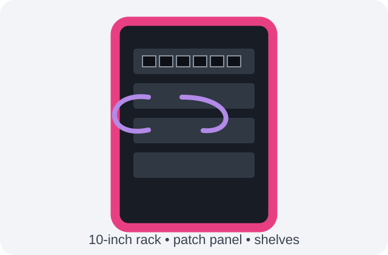
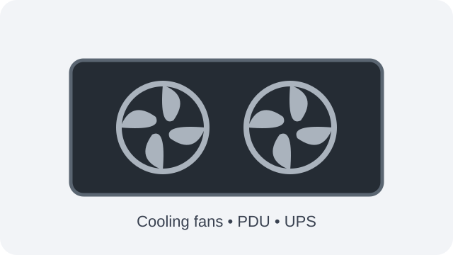

# 10-inch Homelab Shopping List

**Concept:** a compact 10-inch homelab built around an Apple Mac Studio, a Raspberry Pi 5, multi-gigabit networking, and optional NAS storage. The styling follows the pink/purple KWS-style rack in the reference photo.

> **Image note:** The `images/` folder contains locally stored SVG illustrations for the major equipment categories. They are illustrative diagrams, not manufacturer product photographs. Product and manufacturer links are provided below for exact specifications and current availability.

## 1. Core computing

### Apple Mac Studio — M5 Max

- **Suggested starting configuration:** M5 Max, 36GB unified memory, 512GB SSD.
- **U.S. starting price used for this estimate:** $2,499.
- **Recommended upgrade:** 64GB or 128GB unified memory if local AI models, large datasets, or several demanding development workloads are priorities. Consider a larger internal SSD if you want more local working space; external Thunderbolt storage is another option.
- **Role:** primary development workstation, local AI/ML, data science, builds, and heavier compute workloads.
- **Networking:** built-in 10Gb Ethernet.
- **Official links:** [Mac Studio](https://www.apple.com/mac-studio/) · [Technical specifications](https://www.apple.com/mac-studio/specs/)

**Rack fit warning:** Mac Studio is approximately 7.7 × 7.7 × 3.7 inches (W × D × H). Check the rack's *usable internal width and depth*, shelf dimensions, cable clearance, weight rating, and airflow before ordering. Allow at least 3U of vertical space and do not enclose its ventilation openings. If the rack is too cramped, place the Mac Studio beside the rack and connect it over Ethernet/Thunderbolt.

### Raspberry Pi 5 — 8GB

- **Board:** Raspberry Pi 5, 8GB RAM.
- **Planning allowance:** about $95 for the board; retailer pricing and availability vary.
- **Accessories:** official 27W USB-C power supply, Active Cooler, M.2 HAT+ (or compatible PCIe/NVMe adapter), and a 256GB NVMe SSD.
- **Role:** always-on Linux services, Docker containers, DNS/Pi-hole, monitoring, lightweight automation, and Home Assistant.
- **Planning allowance for accessories/storage:** approximately $85–$155, depending on SSD and adapter choice.
- **Official links:** [Raspberry Pi 5](https://www.raspberrypi.com/products/raspberry-pi-5/) · [Raspberry Pi products and accessories](https://www.raspberrypi.com/products/)

## 2. Rack, mounting, and networking

| Item | Suggested choice | Budget estimate | Notes |
|---|---|---:|---|
| Rack frame | KWS Lab Rack V2, 10-inch format | Varies | 3D-print or source the rack parts; confirm exact revision and print material. [MakerWorld design](https://makerworld.com/en/models/2139130-kws-rack-v-2-heavy-duty-10-inch-homelab-rack) |
| Ethernet switch | TRENDnet TEG-S381, 8-port 2.5GbE | ~$200 | Compact multi-gigabit option. Verify current price and whether you need managed/VLAN features before buying. [Manufacturer page](https://www.trendnet.com/support/support-detail.asp?prod=105_TEG-S381) |
| Patch panel | 10-inch, 1U, 12-port Cat6 keystone panel | ~$25 | Use replaceable keystone jacks and short patch cables. [DeskPi Rackmate example](https://deskpi.com/products/deskpi-rackmate-12-port-cat6-keystone-patch-panel-10inch-1u-network-patch-panel-with-cable-management) |
| Mac Studio shelf | Vented 10-inch shelf sized for the Mac Studio | ~$38 | Confirm usable width/depth and load rating; a generic shallow shelf may not fit. |
| Raspberry Pi mount | 10-inch rack mount compatible with Pi 5 and its HAT | ~$40–$91 | Ensure the mount accommodates the selected cooler, HAT, and NVMe drive. |
| Patch cables | Short Cat6/Cat6a cables | ~$15–$30 | Choose lengths that avoid tight bends and obstructed airflow. |

### Network speed note

The Mac Studio has 10Gb Ethernet, but an 8-port 2.5GbE switch limits a single connection to 2.5Gbps unless you add a faster 10GbE path. If fast NAS transfers are important, choose a switch with 10GbE uplinks or a 10GbE-capable switch and verify that the NAS also supports the intended speed. The TRENDnet TEG-S381 is a simple 2.5GbE option; do not assume it provides 10GbE uplinks or advanced managed-switch features.

## 3. Storage and backup (optional but recommended)

- **NAS example:** TerraMaster F4-423 four-bay NAS, or a current equivalent. Check availability because this is an older model.
- **NAS enclosure planning allowance:** approximately $400–$600, depending on model and condition.
- **Drives:** start with 2 × 8TB NAS-rated drives in a mirror if you want redundancy; add drives later as capacity needs grow. Drive costs are additional and fluctuate substantially.
- **Role:** shared datasets, project files, backups, media, and container/application storage.
- **Example product information:** [TerraMaster F4-423 review/spec overview](https://www.neoseeker.com/Articles/Hardware/Reviews/terramaster-f4-423-nas/)

A RAID mirror is not a backup by itself. Keep a separate backup copy, ideally including an off-site or cloud copy for irreplaceable data.

## 4. Power and cooling

| Item | Suggested choice | Budget estimate |
|---|---|---:|
| UPS | APC or CyberPower, approximately 1000–1500VA | $150–$250 |
| PDU / surge protection | Rack-compatible power distribution | $30–$60 |
| Cooling | 40mm fan panel or appropriately sized quiet fans | $25–$40 |
| Temperature monitoring | Pi-compatible temperature sensor | $10–$20 |
| LED accent lighting | Low-voltage purple LED strip | $10–$20 |

A UPS may be too large for a 10-inch rack; placing it beside or below the rack is perfectly reasonable. Size the UPS for the actual load and desired runtime. Keep fan intakes and exhausts unobstructed.

## 5. Suggested rack layout

The following is a conceptual order, not a guaranteed fit. Actual U-height, shelf depth, cooling, and cable routing depend on the chosen rack revision and hardware.

| Position (top to bottom) | Equipment |
|---|---|
| Top | LCD monitoring/status panel |
| 1–2U | 2.5GbE switch |
| 1U | 12-port keystone patch panel |
| 2U | Raspberry Pi 5 with NVMe and rack mount |
| 3U or more | Vented Mac Studio shelf, if the rack's internal dimensions permit |
| 1U | Cooling fan assembly |
| Bottom / adjacent shelf | NAS; may be better placed outside the 10-inch rack |
| Beside or below rack | UPS |

## 6. Estimated budget

### Core build (without NAS, NAS drives, or UPS)

| Category | Planning estimate |
|---|---:|
| Mac Studio M5 Max base configuration | $2,499 |
| Raspberry Pi 5 and accessories | $180–$250 |
| Rack and mounting hardware | $100–$200 |
| Networking and patch panel | ~$225 |
| Cooling, lighting, and PDU | $100–$150 |
| **Estimated core total** | **$3,104–$3,324** |

### Optional additions

| Addition | Planning estimate |
|---|---:|
| NAS enclosure | $400–$600 |
| Two 8TB NAS-rated drives | Additional; check current pricing |
| UPS | $150–$250 |
| Mac Studio memory/storage upgrades | Configure-to-order pricing varies |

**Estimates are planning figures, not live quotes.** They exclude tax, shipping, and any price changes. Verify exact model, compatibility, and seller price before purchasing.

## 7. Suggested software roles

| Hardware | Suggested role / software |
|---|---|
| Mac Studio | SvelteKit development, Docker, local AI with MLX/Ollama, data science, databases, and heavier workloads |
| Raspberry Pi 5 | Pi-hole/DNS, monitoring, Home Assistant, lightweight Docker services, and automation |
| NAS | Shared files, project datasets, snapshots, and backup target |
| Network switch | Wired connectivity between Mac, Pi, NAS, and other devices |

## Purchase checklist

- [ ] Confirm Mac Studio memory and SSD configuration.
- [ ] Measure the rack's internal clear width, depth, and usable U-height.
- [ ] Confirm Mac Studio shelf dimensions, ventilation, and load rating.
- [ ] Select Raspberry Pi power supply, cooler, HAT, and NVMe SSD as a compatible set.
- [ ] Decide whether 2.5GbE is sufficient or whether 10GbE switching is needed.
- [ ] Confirm whether the switch needs VLANs or other managed features.
- [ ] Choose NAS model and drive capacity; budget for a separate backup.
- [ ] Size the UPS for the real equipment load and desired runtime.

---

*Prepared November 9, 2026. Product specifications and pricing can change; manufacturer pages should take precedence over older retailer listings.*
